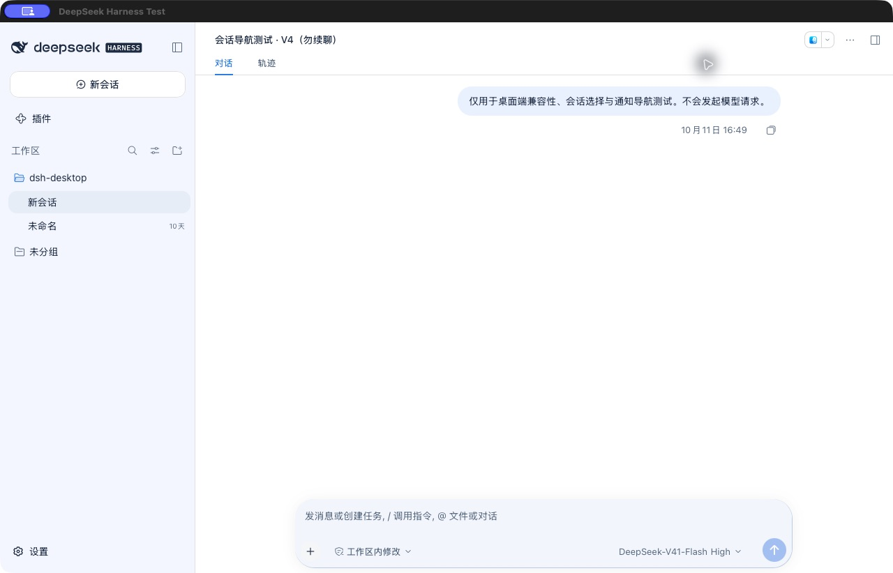
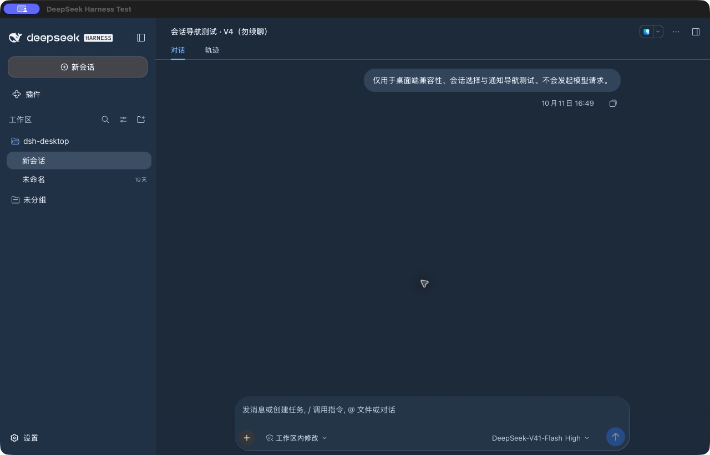

# 蓝白工作区与鲸鱼图标：隔离候选待人工验收

用户已批准参照 v3 蓝白配色实施，并授权重设计程序图标。这是**真实隔离客户端**的结果，不是静态样稿。保留上游布局、聊天、模型／力度／权限选择和原生输入控件；没有为贴近效果图而硬改引擎包或生成的 CSS 类名。

## 实际效果

[760px 窄窗口](workspace-implementation-20261021/light-narrow.png) · [深色设置](workspace-implementation-20261021/dark-settings.png) · [已输入但未发送](workspace-implementation-20261021/input-ready.png)

完整图标由既有构建流程生成 1024px PNG 和 ICNS。保留原鲸鱼轮廓、菜单栏模板和透明外边距，去掉原 DS 字母与渐变；这里的 192px 图片是实际生成图的缩小预览。

## 落地范围

- 使用上游公开 `theme.overrideTokens`，分别提供浅／深色值并在卸载时移除。仅有原生 WebKit 会话处理器的窗口启用，普通浏览器不应用此覆盖；不写入外观偏好、不修改字号。
- 白色阅读区、冷蓝侧栏与输入区、蓝色选中层次；深色独立组成蓝灰层次。保留上游语义错误、警告、成功颜色。
- 真实检查发现的残留炭灰输入／气泡、灰色悬停、占位文字及问题徽标配色已补齐。徽标与普通选中行使用不同背景；前者使用 `#4162EA` 字色和 `#F1F5FF` 背景，对比度 4.63:1。
- 主题 token 是全工作区范围；不是局部截图贴皮。默认按钮形状、主窗口标题栏和不受这些 token 控制的上游品牌字标仍保留。未承诺样稿中的标题排布、会话行分组或新建按钮完全复刻。

## 验证与限制

FOCUSED：12/12 客户端测试 PASS。新增测试先失败再修复，覆盖原生限定、无偏好写入、清理、明暗文字／表面和操作／悬停／徽标颜色配对。数值检查基于实际提交的 token 和已核对的上游消费关系，不冒充全页面 computed-style 审计。

REGRESSION：最终 `Scripts/verify.sh` PASS，包含桥接、安装回滚、WebView 导航、快捷键、Guardian 与图标渲染。BUILD：之前的 `build.sh --test` PASS；本轮补色仅改服务器提供的桥接客户端，无原生二进制改动，未重复构建。测试 App 严格签名检查 PASS。

LIVE ISOLATED：已用既有脚本仅刷新 `.test-home`，仅重启隔离服务；源码与部署的桥接文件逐字节一致。原生客户端中核对桌面／760px 窄窗口、浅色／深色、设置、模型菜单、权限菜单及输入后启用的发送状态。测试文字已清除，没有发送消息、上传文件或填写 API Key。外观已恢复原来的“跟随系统”；测试 App 留在宽窗口以供验收。既有测试通知权限提示仍存在，未改系统通知授权。

未运行：真实模型／付费服务、完整审批与工具运行状态、完整 VoiceOver 键盘遍历、系统色觉模拟、所有上游插件的全状态。明暗配色与关键控件已检查，不等于上述全量验收。HUMAN：PENDING。

正式 App、正式服务与引擎元数据基线哈希仍一致；未安装、升级、推送或改变正式配置。截图只含合成测试会话。原始截图与测试日志保留在忽略的 `bin/blue-theme-*20261021*`；提交目录只保留本次验收材料，无密钥或真实聊天。

GIT：`master` 上已有实施检查点 `d58dfef`，本次补色及证据单独 commit／`fix/` 标签。最终 hash 以 Git 为准。定时任务 `dsh` 在完成此阶段后暂停，避免重复续做。NEXT：用户目测隔离候选；正式部署必须单独确认。
